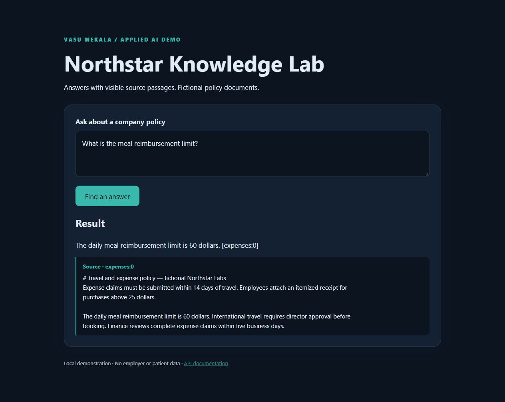
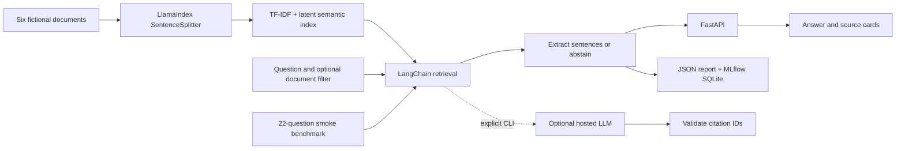

# Northstar Knowledge Lab

**Retrieve the right source, show the evidence, and measure what the answer misses.**




## Problem and scope

Employees need answers from policies and technical guides, with a source they can inspect.
This project demonstrates that workflow using six fictional Northstar Labs documents.
It is a **new November 2026 implementation** of techniques on my resume, not employer code
or a reconstruction of an earlier deployment.

The default path runs locally: LlamaIndex splits documents, TF-IDF plus latent semantic
analysis ranks passages, LangChain composes retrieval and answer selection, and FastAPI
serves the interface. Answers quote source sentences. A separate optional adapter supports
hosted LLM generation with citation-ID validation. That adapter was tested with mock HTTP
responses, not a live/paid model. LSA is a corpus-fitted latent representation, not a pretrained embedding model.

## Architecture



The document filter applies before ranking in both retrieval channels. Documents are data,
not executable instructions. Neither answer path invokes tools. Citation-ID checks do
**not** prove semantic faithfulness.

## Run locally

Use Python 3.12. From this repository:

```sh
python -m venv .venv
# Windows PowerShell: .\.venv\Scripts\Activate.ps1
# macOS/Linux: source .venv/bin/activate
python -m pip install -r requirements-dev.txt
python -m pytest -q
python -m src.evaluate --track
python -m uvicorn src.api:app --host 127.0.0.1 --port 8000
```

Open http://127.0.0.1:8000 and ask “What is the meal reimbursement limit?”
API documentation: `/docs`. Health endpoint: `/health`.
No API key is required for the default demo. Installing dependencies requires internet access.

PowerShell API example:

```powershell
Invoke-RestMethod http://127.0.0.1:8000/ask -Method Post -ContentType application/json -Body '{"question":"When does access expire?","doc_id":"access"}'
```

Tracking writes to a local `mlflow.db` and ignored artifact storage. The checked-in JSON
report is readable without an MLflow server.

## Measured results

Local Windows CPU run: **13 November 2026**. The benchmark was authored alongside the demo:
it is a regression/smoke set, not an independent test of enterprise generalization.
It has **19 answerable and 3 unrelated questions**. Perfect retrieval here is not broad reliability.

| Measure | Observed |
| --- | ---: |
| Correct source document among top 3 | 100.0% |
| Correct source document ranked first | 100.0% |
| Expected phrase included in answer | 84.2% |
| Abstention on three unrelated questions | 100.0% |
| Warm median per-question latency | 12.3 ms |
| Warm p95 per-question latency | 38.5 ms |

Latency excludes startup/index creation and depends on hardware/load. It is not an SLA.
Phrase matching measures narrow answer coverage, **not** faithfulness or hallucination rate.
[Full report](reports/evaluation.json) includes every answer and retrieved passage.

## Failure analysis

Correct retrieval does not guarantee complete answer selection. These misses are retained:

| Question | Expected detail | Actual answer |
| --- | --- | --- |
| Who approves production access? | service owner | Employees request production access through the Access Portal. Contractors cannot receive production access under this policy. [access:0] |
| When does access expire? | 30 days | Employees request production access through the Access Portal. Contractors cannot receive production access under this policy. [access:0] |
| How frequently should incident updates be posted? | 30 minutes | The incident commander coordinates recovery; the communications lead updates customers. Store incident evidence in the incident workspace. [incident:0] |

Next experiment: add independently authored paraphrases and difficult unanswerable queries.
Compare pretrained sentence embeddings and cited LLM generation with this baseline; record
model versions, latency/cost, coverage and manual grounding judgments. Select thresholds
on a separate validation set.

## Optional hosted generation

Set `LLM_BASE_URL` (OpenAI-compatible endpoint ending in `/v1`), `LLM_MODEL` and `LLM_API_KEY`
locally, then explicitly run:

```sh
python -m src.generation "What is the meal reimbursement limit?"
```

This sends the question and fictional source passages to the configured provider and may
incur normal API charges. JSON-mode support varies. The adapter rejects missing/unknown
source IDs but does not independently verify every generated claim. No live provider
execution or cloud deployment is claimed.

## Tests, notebook and container

**Eight tests passed locally**: extraction, abstention, source IDs, document-filter isolation,
untrusted-source handling, API validation and the mocked hosted adapter. Notebook code cells
were also executed against the implementation.

```sh
docker build -t northstar-knowledge-lab .
docker run --rm -p 8000:8000 northstar-knowledge-lab
```

Docker was unavailable locally, so image build/run remains unverified. The supplied CI
workflow runs tests and builds the image after publication; it has not run on GitHub yet.
The demo binds to loopback. Authentication, authorization, persistent ingestion, rate limits
and monitoring remain deployment work.

## Repository map

```text
src/           retrieval, optional generation, API and evaluation
data/          fictional documents and benchmark questions
tests/         regression and API tests
web/           responsive demo interface
notebooks/     executable walkthrough
reports/       measured results and reproduction manifest
docs/          screenshot, provenance and future commit plan
```

[Provenance](docs/PROVENANCE.md) · [Future commit plan](docs/COMMIT-PLAN.md) · [MIT](LICENSE)
